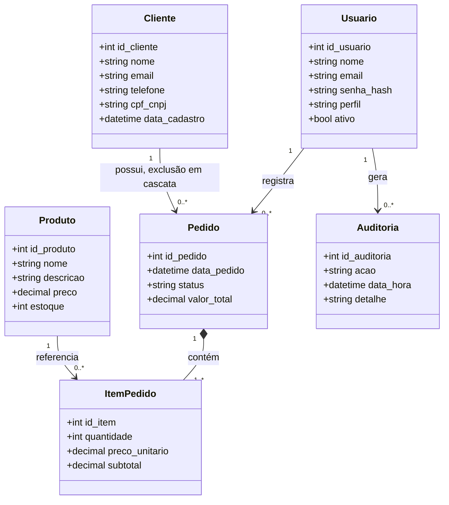
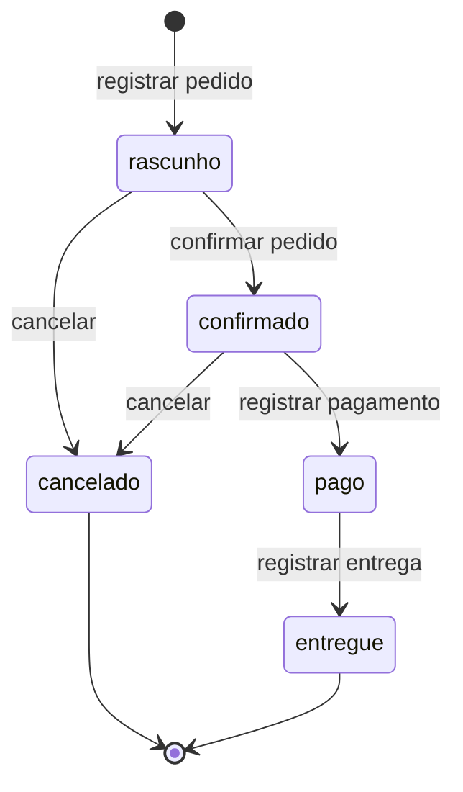
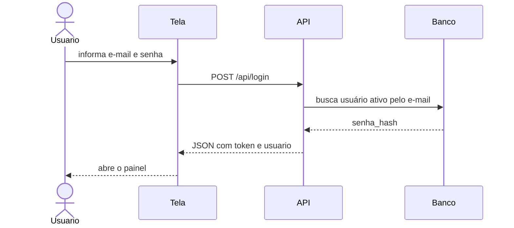

# Sistema Comercial

Sistema web para o controle de clientes, produtos e pedidos de uma loja. A aplicação oferece uma tela de acesso, um painel inicial e o cadastro operacional usado no dia a dia do balcão.

O painel inicial resume a operação com três indicadores: total de clientes cadastrados, quantidade de produtos ativos em estoque e faturamento do mês corrente.

## Tecnologias

- Node.js com módulos ES
- Express 5
- PostgreSQL
- Páginas HTML, CSS e JavaScript em `public/`
- Autenticação por JWT

## Como executar

1. Instale Node.js, PostgreSQL e OpenSSL. No Windows, o script de certificado também detecta o OpenSSL instalado com o Git.
2. Crie o banco `sistema_comercial` no PostgreSQL.
3. Crie um arquivo `.env` na raiz do projeto:

```env
PORT=3000
DB_HOST=localhost
DB_PORT=5432
DB_USER=postgres
DB_PASSWORD=sua_senha
DB_NAME=sistema_comercial
JWT_SECRET=troque_por_uma_chave_secreta_longa_e_aleatoria
```

4. Na primeira instalação, execute na pasta do projeto:

```bash
npm install
npm run cert:dev
npm run db:migrate
npm start
```

O comando `db:migrate` cria a estrutura e os dados de demonstração se o banco estiver vazio. Se o banco já tiver a estrutura anterior, ele aplica a migração sem recriar usuários. Não execute `database/sql.sql` antes desse procedimento: esse arquivo é uma alternativa para instalação manual em banco novo.

Se os certificados já existirem, pule `npm run cert:dev`: ele não sobrescreve os arquivos. Para iniciar nas próximas vezes, basta executar `npm start` e manter o terminal aberto.

5. Abra **https://localhost:3000/login**. É necessário usar **https://**, pois a aplicação não atende em HTTP. Se `PORT` não estiver definido, o endereço será **https://localhost:8080/login**.

### Se aparecer “Sua conexão não é particular”

No desenvolvimento, o certificado local é autoassinado e o Chrome ou Edge pode mostrar um aviso de privacidade antes de abrir a aplicação.

1. Confira se está acessando o endereço local do projeto: `https://localhost:3000/login` (ou a porta configurada).
2. Clique em **Avançadas**.
3. Clique em **Continuar para localhost (não seguro)** para abrir a tela de login. O texto pode variar um pouco conforme o navegador.

Use essa exceção somente para o localhost deste projeto. Em produção, configure um certificado HTTPS válido.

### Se não conectar ao servidor

- Confirme que `npm start` continua em execução e que o terminal mostra “Servidor rodando com HTTPS na porta …”.
- Confira a porta indicada no terminal e a variável `PORT` no `.env`.
- Se o terminal indicar erro de banco, verifique se o PostgreSQL está iniciado e se as variáveis `DB_*` estão corretas.
- Se indicar certificado ausente, execute `npm run cert:dev` e tente iniciar novamente.

A opção **Avançadas** resolve o aviso do certificado; ela não resolve servidor desligado, porta incorreta ou erro de banco. A aplicação só abre a porta depois de confirmar a conexão com PostgreSQL.

## Usuários de demonstração

O script de instalação em banco novo grava dois usuários ativos. Instalações existentes preservam suas credenciais durante a migração.

| Nome | E-mail | Senha | Perfil |
| --- | --- | --- | --- |
| Administrador | admin@comercial.com | admin123 | admin |
| Funcionário | funcionario@comercial.com | func123 | funcionario |

Usuário com `ativo = false` não consegue entrar. E-mail ou senha incorretos devolvem a mesma mensagem, sem indicar qual dos dois campos falhou.

## Estrutura do projeto

```text
projeto-manutencao/
├── certs/          # Certificado local e chave privada (não versionados)
├── database/       # Instalação e migração do PostgreSQL
├── public/         # HTML, CSS e JavaScript das telas
├── scripts/        # Certificado, migração e testes de integração
├── src/            # Servidor HTTPS, API, autenticação e validações
├── .env            # Configuração local (não versionada)
├── package.json
└── README.md
```

A interface estática fica em `public/`. As rotas de negócio ficam em `src/routes.js` e são publicadas sob o prefixo `/api`.

## Arquitetura

O navegador conversa com uma API HTTPS em JSON. O login valida o e-mail e a senha e devolve um token JWT, válido por 2 horas, junto com os dados do usuário. A tela guarda o token e o usuário no `localStorage` e envia o token no cabeçalho `Authorization` nas chamadas seguintes.

A gravação de um pedido usa uma transação: o pedido, os itens e a baixa de estoque são confirmados juntos. Qualquer falha desfaz a operação inteira.

## Diagramas UML

### Diagrama de classes



`perfil` aceita apenas `admin` ou `funcionario`. O status do pedido aceita `rascunho`, `confirmado`, `pago`, `entregue` e `cancelado`.

### Diagrama de estados do pedido



Pedido `pago` ou `entregue` é final: a API recusa o cancelamento e o estoque não é alterado.

### Sequência do login



## Modelo de dados

| Tabela | Papel | Colunas principais |
| --- | --- | --- |
| `usuarios` | Quem acessa o sistema | `id_usuario`, `nome`, `email`, `senha_hash`, `perfil`, `ativo` |
| `clientes` | Cadastro de clientes | `id_cliente`, `nome`, `email`, `telefone`, `cpf_cnpj`, `data_cadastro` |
| `produtos` | Catálogo e saldo | `id_produto`, `nome`, `descricao`, `preco`, `estoque` |
| `pedidos` | Cabeçalho da venda | `id_pedido`, `id_cliente`, `id_usuario`, `data_pedido`, `status`, `valor_total` |
| `itens_pedido` | Linhas da venda | `id_item`, `id_pedido`, `id_produto`, `quantidade`, `preco_unitario`, `subtotal` |
| `auditoria` | Histórico das operações | `id_auditoria`, `id_usuario`, `acao`, `data_hora`, `detalhe` |

Regras estruturais adotadas no banco:

- `clientes.email` e `clientes.cpf_cnpj` são obrigatórios e únicos.
- `produtos.preco` precisa ser maior que zero. `produtos.estoque` pode ficar negativo.
- A exclusão de um cliente remove os pedidos dele e, em seguida, os itens desses pedidos.
- `itens_pedido` guarda quantidade e subtotal. O preço unitário exibido acompanha o preço atual do produto, e pedidos ainda não entregues são recalculados quando esse preço muda.

O script de demonstração carrega os clientes João Pereira, Maria Oliveira, Pedro Santos e Ana Costa, e os produtos Notebook (R$ 3.500,00), Mouse (R$ 80,00), Teclado (R$ 120,00), Monitor (R$ 950,00), Headset (R$ 180,00) e Webcam (R$ 250,00).

## Requisitos funcionais

### RF01 — Acessar o sistema

O usuário entra em `/login` com e-mail e senha. Usuário inativo não entra. Credencial inválida gera uma única mensagem genérica.

### RF02 — Respeitar o perfil

O administrador consulta, cadastra, edita, exclui clientes, desativa produtos e cancela pedidos. O funcionário consulta, cadastra e edita, e a API responde `403` quando ele tenta excluir cliente, desativar produto ou cancelar pedido.

### RF03 — Cadastrar cliente

O cadastro exige nome, e-mail e CPF/CNPJ. O telefone é opcional. O CPF deve ter 11 dígitos e o CNPJ, 14. E-mail repetido ou documento repetido devolve `409`.

### RF04 — Consultar e editar cliente

A grade de clientes exibe nome, e-mail, telefone e CPF/CNPJ, em ordem de cadastro. A edição altera nome, e-mail, telefone e documento do cliente escolhido.

### RF05 — Excluir cliente

A exclusão do cliente remove também os pedidos vinculados e os itens desses pedidos.

### RF06 — Manter o catálogo de produtos

O usuário cadastra e edita produto com nome, descrição, preço e estoque. O preço precisa ser maior que zero. A listagem mostra somente produtos ativos, ordenados pelo identificador.

### RF07 — Excluir produto

A ação **Excluir** apaga o registro de forma definitiva na tabela `produtos`. O produto deixa de existir para consulta, edição e novos pedidos.

### RF08 — Registrar, consultar e acompanhar pedidos

O pedido informa um cliente já cadastrado e pelo menos um produto. O valor total mínimo é R$ 50,00. Quantidade maior que o estoque não impede o registro. Incluir o mesmo produto duas vezes no mesmo pedido devolve `409`.

A listagem mostra número, cliente, vendedor, data, status e total. O detalhe lista os produtos, as quantidades e os subtotais. A mudança de status é feita em `PUT /api/pedidos/:id/status`. O cancelamento usa `DELETE /api/pedidos/:id` e só é aceito nos status `rascunho` e `confirmado`.

## Requisitos não funcionais

### RNF01 — Persistência e partida

Os dados ficam no PostgreSQL, no banco `sistema_comercial`. A aplicação só começa a atender requisições depois de executar `SELECT NOW()` com sucesso.

### RNF02 — Proteção da senha

A senha é armazenada como hash bcrypt com salt aleatório e custo mínimo 12. Hashes de custo menor são atualizados no próximo login correto. Essa revisão de RNF02 foi autorizada pelo usuário e substitui SHA-256 sem salt.

### RNF03 — Execução

O comando oficial de subida é `npm start`. Na ausência de `PORT`, o processo escuta a porta `8080`.

### RNF04 — Paginação

As consultas de clientes, produtos e pedidos aceitam `page` e `limit`. O padrão é 10 registros por página, e a interface oferece os controles de página anterior e próxima.

### RNF05 — Idioma e moeda

Textos da interface e mensagens da API estão em português do Brasil. Valores monetários são apresentados em real (BRL).

### RNF06 — Auditoria

Cada inclusão, alteração e exclusão grava uma linha na tabela `auditoria`, com usuário, ação, data e detalhe. A consulta fica em `GET /api/auditoria`.

### RNF07 — Transporte

Toda comunicação com a API, inclusive no ambiente de desenvolvimento, usa HTTPS.

### RNF08 — Consistência do pedido

A criação do pedido é transacional. Pedido, itens e movimentação de estoque são confirmados em conjunto ou desfeitos por completo.

## Regras de negócio

### RN01 — Operações por perfil

Somente o perfil `admin` pode excluir cliente, desativar produto e cancelar pedido. O perfil `funcionario` fica limitado à consulta, ao cadastro e à edição.

### RN02 — Identificação do cliente

E-mail e CPF/CNPJ são obrigatórios e únicos. O documento só é aceito com 11 dígitos (CPF) ou 14 dígitos (CNPJ), sem pontuação.

### RN03 — Produto fora de linha

Produto inativo não aparece na listagem e não pode ser incluído em um pedido novo.

### RN04 — Pedido mínimo

Todo pedido precisa de um cliente existente, de ao menos um item com quantidade inteira maior que zero e de valor total igual ou superior a R$ 50,00.

### RN05 — Estoque descoberto

Se a quantidade pedida for maior que o saldo, o pedido é aceito mesmo assim e o estoque do produto fica negativo até uma reposição posterior.

### RN06 — Cancelamento

Só é possível cancelar pedido em `rascunho` ou `confirmado`. O cancelamento devolve as quantidades ao estoque. Pedido `pago` ou `entregue` não pode ser cancelado.

## API

As rotas abaixo, exceto o login e a verificação de status, exigem o token JWT obtido no login.

| Método | Caminho | Comportamento |
| --- | --- | --- |
| `GET` | `/api/status` | Informa que o sistema está em funcionamento |
| `POST` | `/api/login` | Valida e-mail e senha e devolve o token JWT |
| `GET` | `/api/clientes` | Lista clientes paginados |
| `POST` | `/api/clientes` | Cadastra cliente. `409` se e-mail ou documento já existir |
| `PUT` | `/api/clientes/:id` | Atualiza cliente. `404` se o id não existir |
| `DELETE` | `/api/clientes/:id` | Exclui cliente e os pedidos em cascata. `403` para funcionário |
| `GET` | `/api/produtos` | Lista produtos ativos paginados |
| `POST` | `/api/produtos` | Cadastra produto |
| `PUT` | `/api/produtos/:id` | Atualiza produto ativo. `404` se não existir |
| `DELETE` | `/api/produtos/:id` | Apaga o produto. `403` para funcionário |
| `GET` | `/api/pedidos` | Lista pedidos paginados, do mais recente para o mais antigo |
| `GET` | `/api/pedidos/:id` | Devolve o cabeçalho e os itens |
| `POST` | `/api/pedidos` | Registra pedido em `rascunho` |
| `PUT` | `/api/pedidos/:id/status` | Altera o status conforme o diagrama de estados |
| `DELETE` | `/api/pedidos/:id` | Cancela o pedido, quando o status permitir. `403` para funcionário |
| `GET` | `/api/auditoria` | Lista o histórico de operações |

Códigos usados pela API:

- `200` para consulta, atualização e cancelamento concluídos
- `201` para cadastro concluído
- `400` para dados obrigatórios ausentes ou pedido abaixo do valor mínimo
- `401` para token ausente, inválido ou expirado
- `403` para funcionário em operação exclusiva do administrador
- `404` para cliente, produto ou pedido inexistente
- `409` para e-mail ou documento de cliente já cadastrado, ou produto repetido no pedido
- `500` para falha inesperada

Exemplo de registro de pedido:

```json
{
  "id_cliente": 1,
  "itens": [
    { "id_produto": 2, "quantidade": 1 },
    { "id_produto": 3, "quantidade": 2 }
  ]
}
```

Exemplo de mudança de status:

```json
{
  "status": "pago"
}
```

## Instalação e migração implementadas

- O certificado local é gerado por `npm run cert:dev`, usando OpenSSL. No Windows, o script detecta o OpenSSL do Git; em outro local, configure OPENSSL. O comando não sobrescreve certificados existentes.
- Execute `npm run db:migrate`: banco vazio recebe estrutura e dados demonstrativos; banco existente recebe migração transacional, sem recriar usuários ou apagar registros. Dados antigos incompatíveis cancelam a migração e precisam ser corrigidos antes de tentar novamente.
- `npm start` serve somente HTTPS. A porta padrão é 8080; PORT no .env prevalece (o exemplo usa 3000). Não existe servidor HTTP paralelo.
- TLS_KEY e TLS_CERT permitem configurar caminhos para chave e certificado próprios. O certificado local é autoassinado: o navegador pede confiança explícita. Em produção use certificado válido. Chaves privadas locais não são versionadas.
- Após `npm run db:migrate`, não execute sql.sql novamente no mesmo banco. Esse arquivo serve para instalação nova.

## Contrato da API e decisões de consistência

- As listas devolvem `{ dados, page, limit, total, paginas }`; page padrão 1, limit padrão 10, máximo 100. A tela oferece Anterior/Próxima. Os seletores de pedido percorrem todas as páginas, sem limitar opções à primeira página.
- PUT de produto exige `versao`, obtida no GET. Vendas, reposições e cancelamentos incrementam a versão; formulário antigo retorna 409 e exige recarga, evitando sobrescrever estoque.
- DELETE de produto é exclusão definitiva (RF07). PATCH `/api/produtos/:id/desativar` é uma ação separada de desativação (RN01/RN03). Ambas são exclusivas do administrador.
- Itens conservam nome e preço registrados. Quando o produto é apagado, a referência fica nula e o detalhe da venda continua disponível. Não há estoque de produto apagado para movimentar em cancelamentos posteriores.
- Como no documento original, o preço unitário mostrado acompanha o catálogo enquanto o produto existir; pedidos ainda não entregues, inclusive pagos/cancelados, são recalculados quando o preço muda. Os subtotais de entregues permanecem preservados. Uma alteração de preço que faça um pedido recalculado cair abaixo de R$ 50 é rejeitada integralmente.
- A exclusão de cliente remove pedidos e itens em cascata, como RF05. Ela não representa cancelamento e não devolve estoque; o histórico da exclusão permanece na auditoria.
- A API de status respeita rascunho → confirmado → pago → entregue. Cancelamento apenas em rascunho/confirmado, também via status, exige administrador. PATCH `/api/pedidos/:id/cancelar` permanece como compatibilidade.
- Auditoria é gravada por triggers na mesma transação, com usuário, ação, data e antes/depois. Falha e rollback não deixam auditoria parcial; hashes de senha são excluídos dos detalhes. A carga inicial/migração tem autoria de sistema (id nulo).
- GET `/api/painel` conta clientes, produtos ativos com saldo positivo e faturamento de pedidos pagos/entregues criados no mês corrente. GET `/api/me` informa o usuário e perfil atuais.
- As alterações comerciais usam uma ordem global de execução no PostgreSQL para evitar ciclos de bloqueio entre preços, vendas e estoque. É uma escolha simples para este sistema; pode limitar a vazão em uso intenso.

## Segurança

- Senhas são armazenadas com bcrypt, salt aleatório e custo mínimo 12. Hashes antigos de menor custo são atualizados após o login correto.
- A função de criação de hash exige senhas novas com pelo menos 12 caracteres e no máximo 72 bytes UTF-8. O login preserva a compatibilidade com senhas antigas e de demonstração.
- JWT usa HS256 e expira em duas horas. Use uma chave JWT_SECRET longa e aleatória.
- Cada requisição autenticada confere no banco se o usuário está ativo e consulta seu perfil atual. Desativação e redução de permissões passam a valer na próxima requisição.
- O login permite até 20 requisições por IP em 15 minutos; ao exceder, retorna 429 com Retry-After. Esse contador é local ao processo; várias instâncias exigem um contador compartilhado.
- A resposta de login não deve ser armazenada em cache. Senhas e hashes não são enviados no token nem incluídos nos detalhes da auditoria.
- O token permanece no localStorage conforme a arquitetura do sistema. Não há recuperação de senha, segundo fator nem revogação individual de token ao sair.

## Testes

```bash
npm test
```

`npm run test:integration` executa a mesma suíte. Os testes iniciam a aplicação real em HTTPS, conferem a API e o PostgreSQL e exercitam as telas no navegador. Não geram relatórios ou capturas de tela em disco; o resultado aparece no terminal.

Pré-requisitos:

- Dependências instaladas, `.env` configurado e certificados locais existentes.
- Conta PostgreSQL com permissão para criar/remover o banco temporário e instalar a extensão pgcrypto nele.
- Edge instalado no caminho padrão do Windows, ou BROWSER_EXECUTABLE definido com o caminho de um navegador Chromium compatível.

A suíte cria um banco exclusivo e remove somente esse banco ao terminar. Os dados comerciais não são usados pelos cenários. Os dados do esquema legado necessários para testar a migração estão incluídos no próprio script, sem depender de relatórios ou arquivos históricos externos.
